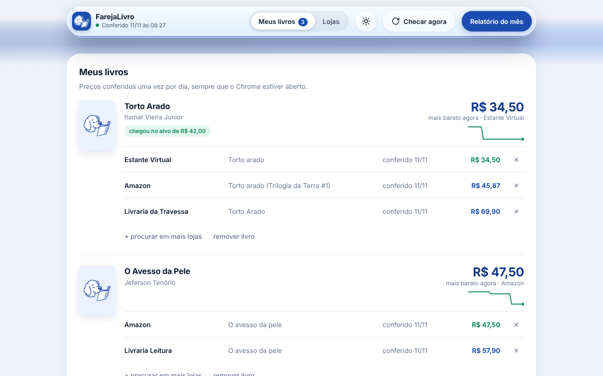
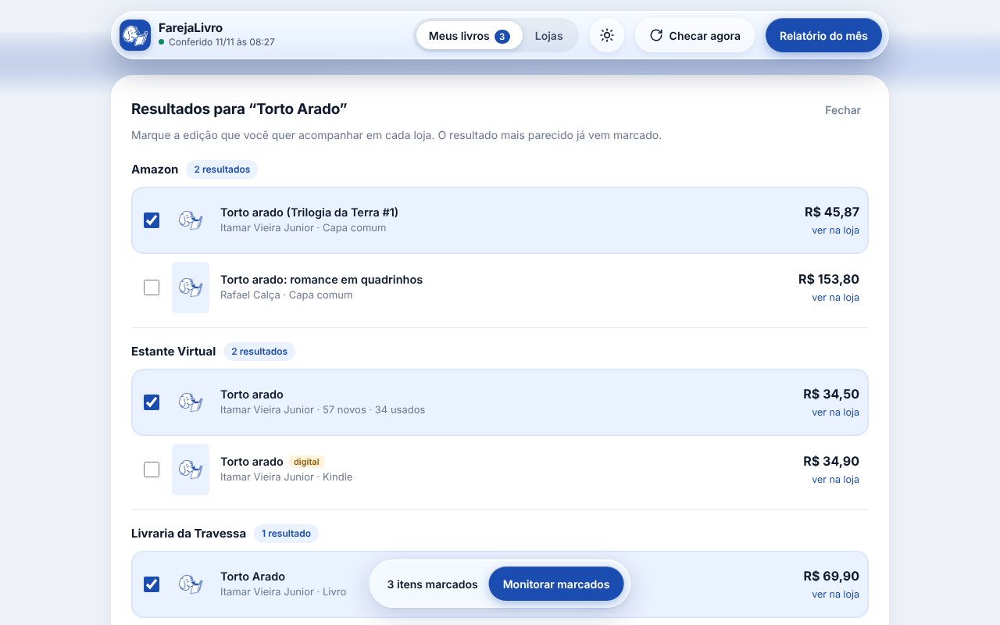
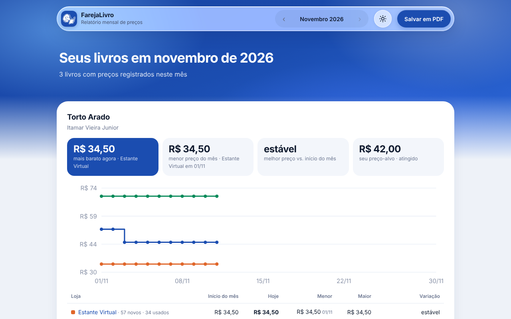

  

# FarejaLivro

Extensão gratuita para o Google Chrome que procura um livro nas lojas do Brasil, confere o preço todo dia ou toda semana e avisa com um latido quando ele cai. Tem indicações de livros da equipe e dos leitores e, no dia 1 de cada mês, um relatório com a variação de preço de cada loja.

## O que ela faz

- **Busca em várias lojas de uma vez.** Você digita o nome do livro e o autor, e ela mostra o resultado de cada loja com capa, edição e preço.
- **Você escolhe a edição.** O resultado mais parecido já vem marcado. É só confirmar ou trocar, para não acompanhar o e-book ou a edição errada.
- **Confere o preço todo dia ou toda semana.** Você escolhe, na aba Lojas. Funciona sempre que o Chrome estiver aberto.
- **Avisos configuráveis, com latido.** Quando o livro chega no seu preço-alvo, no menor preço já visto ou cai uma porcentagem que você escolhe.
- **Indicações de livros.** Da equipe e dos leitores, filtradas pelas categorias que você segue. Dá para indicar um livro e mandar monitorar o preço de uma indicação com um clique.
- **Relatório mensal.** O preço de cada loja no início e no fim do mês, o menor e o maior, a variação e um gráfico. Dá para salvar em PDF.
- **Modo claro e escuro.** Pode seguir o tema do computador ou ser escolhido na mão.

| Busca nas lojas | Relatório do mês |
| --- | --- |
|  |  |

## Lojas

Amazon, Estante Virtual (novos e usados), Mercado Livre, Magazine Luiza, Livraria Leitura e Livraria da Travessa.

Para adicionar outra livraria:

1. Abra o site da loja e pesquise a palavra **livro**.
2. Copie o endereço da página de resultados.
3. Na aba **Lojas** da extensão, cole o endereço, dê um nome e clique em **Adicionar loja**.

O Chrome vai pedir permissão para a extensão ler aquele site. A extensão testa a loja na hora e avisa se conseguiu ler os preços.

## Instalar

**Pela Chrome Web Store:** em breve.

**Direto do GitHub (1 minuto):**

1. Baixe o arquivo `farejalivro.zip` na página de [Releases](../../releases) e descompacte numa pasta que você não vá apagar.
   Se preferir, use **Code → Download ZIP** nesta página e, depois de descompactar, use a pasta `extension`.
2. No Chrome, abra `chrome://extensions`.
3. Ligue o **Modo do desenvolvedor**, no canto superior direito.
4. Clique em **Carregar sem compactação** e escolha a pasta da extensão (a que tem o arquivo `manifest.json` dentro).
5. Fixe o FarejaLivro na barra do Chrome pelo ícone de quebra-cabeça.

## Privacidade

Seus livros, preços e preferências ficam no seu computador. A extensão não tem cadastro. Só sai do seu computador a indicação de livro que você decidir enviar. Leia a [política de privacidade](PRIVACIDADE.md).

**Links de afiliado:** as indicações da equipe têm o botão **Comprar no Mercado Livre**, que é um link de afiliado. Se você comprar por ele, o FarejaLivro ganha uma comissão e você não paga nada a mais. Esse dinheiro ajuda o projeto a virar app para celular. Nenhum outro link da extensão tem comissão.

O FarejaLivro não tem relação com as lojas citadas. Os nomes das lojas pertencem aos seus donos.

## Como funciona por dentro

Extensão Manifest V3, em JavaScript puro, sem bibliotecas e sem build.

| Arquivo | Função |
| --- | --- |
| `extension/manifest.json` | Configuração, permissões e lojas com acesso liberado |
| `extension/stores.js` | Lojas padrão: endereço de busca e onde fica título, preço e link em cada uma |
| `extension/extractor.js` | Lê busca e página de produto. Usa os seletores da loja e, se falharem, um leitor genérico (JSON-LD, metatags, preço em destaque) |
| `extension/engine.js` | Busca, pontuação dos resultados, checagem diária, histórico e resumo do mês |
| `extension/background.js` | Alarme de hora em hora, conferência diária ou semanal, avisos de preço com latido, número de indicações novas no ícone e aviso do relatório |
| `extension/indicacoes.js` / `ind-ui.js` | Aba Indicações: lê as indicações publicadas e envia as dos leitores para revisão |
| `extension/config.js` / `avisos-ui.js` | Preferências de conferência e avisos |
| `extension/offscreen.*` | Lê o HTML das lojas em segundo plano e toca o latido (o service worker não tem DOMParser nem áudio) |
| `equipe/` | Painel da equipe (GitHub Pages): aprova indicações dos leitores e publica as da equipe |
| `supabase/schema.sql` | Estrutura e regras de segurança do banco das indicações |
| `extension/app.*` | Página principal: busca, meus livros, lojas e apoio |
| `extension/report.*` | Relatório mensal com gráfico |
| `extension/theme.js` | Modo claro, escuro e automático |

Quando uma loja só mostra o preço depois de carregar a página, a extensão abre essa página numa janela minimizada, lê o preço e fecha.

## Contribuir

Achou uma loja que parou de funcionar ou quer sugerir uma nova? Abra uma [issue](../../issues).

Para ajustar uma loja padrão, edite a receita dela em `extension/stores.js`. Cada loja tem o endereço de busca (`{q}` é o termo pesquisado) e os seletores CSS do cartão do produto, do título, do preço e do link. Depois, recarregue a extensão em `chrome://extensions`.

## Apoie o projeto

O FarejaLivro é gratuito. Se ele te ajudou a pagar menos num livro, você pode apoiar com qualquer valor.

| Pix | Buy Me a Coffee |
| :---: | :---: |
|  |  |
| Qualquer valor | [buymeacoffee.com/oalvxs](https://www.buymeacoffee.com/oalvxs) |

## Licença

[MIT](LICENSE). Pode usar, copiar e modificar, mantendo o aviso de autoria.
